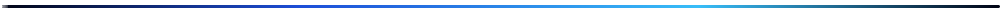
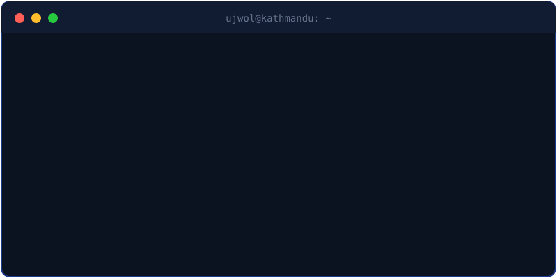

  

 

## About Me

  

 

I'm a frontend developer who enjoys turning ideas into fast, responsive, user-friendly web applications. I work with **React.js, JavaScript and REST APIs**, and I'm growing into backend development and database-driven apps.

## Tech Universe

  

   

  

## Featured Projects

  

<b>Developer Portfolio</b>

 

My personal portfolio showcasing my skills, selected projects and work.

| | |
|---|---|
| **Frontend** | React.js, JavaScript, CSS |
| **Focus** | Responsive design and user experience |
| **Website** | [shresthaujwol.com.np](https://shresthaujwol.com.np) |
| **Source** | [View repositories](https://github.com/itsujwal11?tab=repositories) |

## GitHub Stats

  
  
   
  
    
  

## Currently

  

## Beyond the Code

  <!-- To use your own artwork instead, replace the src with your image/GIF -->
  

